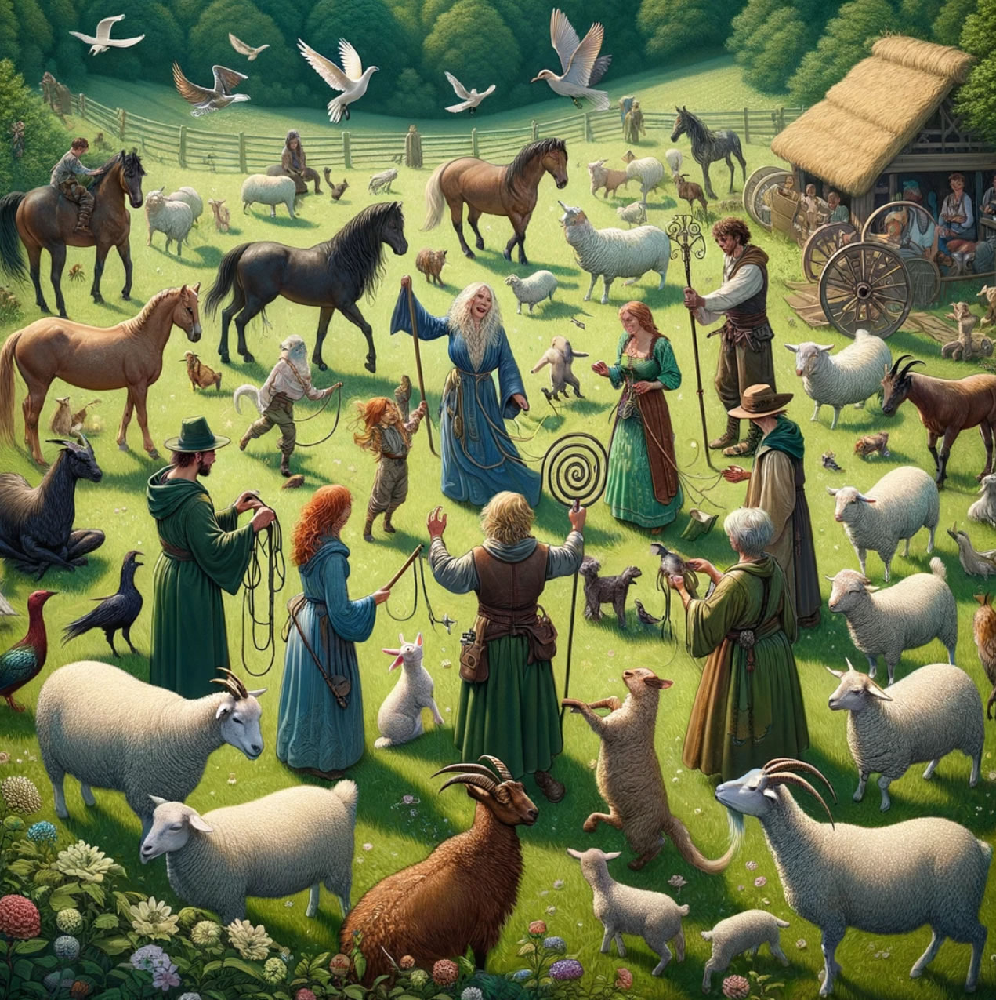

## Faunamancers' Guild

### Mission
Companions to animals, Faunamancers ensure harmonious coexistince between the community and the local wildlife, ensuring the preservation of desert ecosystems and biodiversity.

### Projects

#### Habitat Creation
Design and construct wildlife-friendly habitats to protect native species and encourage biodiversity.  
[Learn More](https://highdesertinstitute.org/guilds/faunamancers/habitat-creation)

#### Desert Wildlife Monitoring
Use cameras and other tools to monitor local wildlife populations and behavior patterns.  
[Learn More](https://highdesertinstitute.org/guilds/faunamancers/wildlife-monitoring)

#### Wildlife Corridors
Develop and maintain wildlife corridors to help animals safely traverse between protected areas.  
[Learn More](https://highdesertinstitute.org/guilds/faunamancers/wildlife-corridors)

#### [Solar Chicken Pipeline](/projects/solar-chicken-pipeline/)
Grow algae with sunlight, feed it to black soldier fly larvae, and use the larvae to supplement a balanced diet for laying hens.
