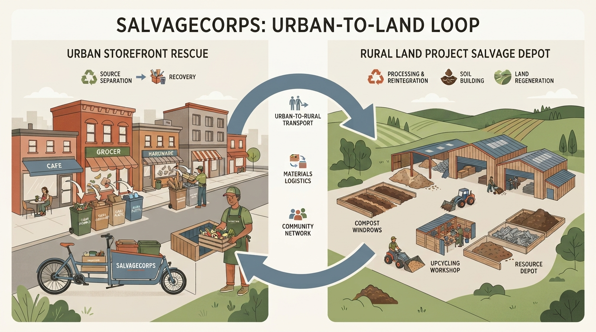

# SalvageCorps

SalvageCorps grew out of conversations with people about how much usable food and building material gets thrown away and what our land projects could do about it. We scout for surplus, arrange pickups with farms and businesses, and salvage usable discards, including from commercial dumpsters where we have permission. We work with the [Gastronomers](/guilds/gastronomers/) and local food-sharing partners to get safe surplus food to people, and with the [Artificers](/guilds/artificers/) to source materials for repairs and construction.

## What we learned at Emberfield

During the two-month build at [Emberfield](https://emberfield.org/), the Missouri land project featured in Discovery Channel’s [*The Garden: Commune or Cult*](https://press.wbd.com/us/media-release/discovery-channel/discovery-cameras-venture-controversial-grid-community-new-series-garden-commune-or), most of the food that fed our crew came from other farms and communes or from dumpsters in nearby cities. We also salvaged much of what we built with from commercial dumpsters, including at Tractor Supply and Home Depot. One of our favorite finds was a fancy claw-foot bathtub. Our crew remembers the stores being fine with us taking what they had discarded.

## Why we rescue food

[USDA estimates](https://www.usda.gov/about-food/food-safety/food-loss-and-waste/food-waste-faqs) that 30–40% of the U.S. food supply goes to waste. [EPA estimated](https://www.epa.gov/system/files/documents/2024-04/2019-wasted-food-report_508_opt_ec_4.23correction.pdf) that about 60% of wasted food from food retail, food service, and households went to landfills in 2019. The [USDA’s 2024 food security report](https://ers.usda.gov/sites/default/files/_laserfiche/publications/113623/ERR-358.pdf?v=25559) found that 18.4% of U.S. households with children experienced food insecurity and that 14.1 million children lived in those households.

Corporations have a responsibility to make safe surplus food and usable goods available to people who need them. Destroying those goods or keeping them out of reach wastes resources that could feed families or help build homes. Stores can set surplus aside, arrange recurring pickups, and work with food pantries and community kitchens so food reaches people while it is still safe. For community distribution, we prioritize direct handoffs before food goes into the waste stream, so its source and handling can be verified and perishables can be [kept at safe temperatures](https://www.fda.gov/food/retail-food-industryregulatory-assistance-training/key-steps-donating-food-retail-food-establishments).

## A salvage depot for each land project

SalvageCorps will organize a depot at each land project. We’ll keep track of what builders need, collect things like lumber, doors, hardware, and fixtures, and sort and label them by condition and intended use. The depot gives crews a place to find stock for upcoming builds, repair or upcycle items, and send what can’t be reused to the appropriate recycler.

## Compost and animal feed

With the [Floramancers](/guilds/floramancers/), we’ll turn suitable scraps into compost that adds organic matter and helps dry soils hold water. Cafés are a regular source of spent coffee grounds. We can mix them and fruit and vegetable trimmings with dry leaves or other carbon-rich material in a rodent-resistant bin. Meat, fish, and bones can [attract rats to compost piles](https://www.epa.gov/recycle/composting-home), so we keep them out of site compost and send them to a composting facility that accepts them where one is available.

Some clean, traceable by-products, such as [spent brewery grains](https://extension.entm.purdue.edu/publications/E-276/E-276.html) or separated vegetable trimmings, are candidates for animal feed. SalvageCorps will help the [Faunamancers](/guilds/faunamancers/) identify suitable sources for the [Solar Chicken Pipeline](/projects/solar-chicken-pipeline/) and [keep those materials separate from mixed scraps](https://www.fda.gov/media/97470/download).
