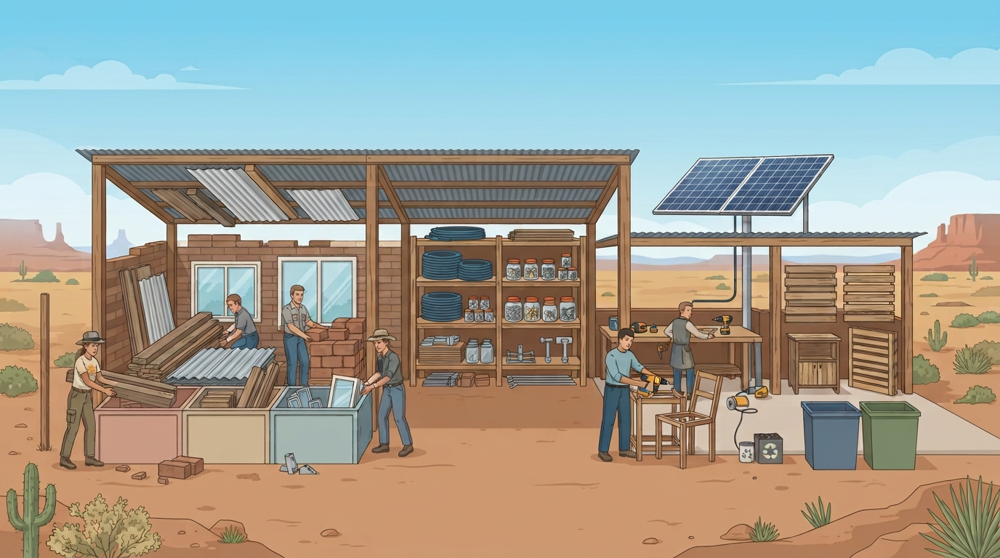

## Close your loops

The depot’s goal is zero waste. Look at what you regularly bring in and what regularly leaves as waste. For each outgoing stream, ask what would eliminate it. If you bring in soil amendments and regularly have plant scraps, make compost. If broken fixtures leave the site and you keep buying hardware for repairs, save usable hinges and fasteners for the next job. If a material has no practical use once you’re done with it, look for a reusable input that can do the same job.

## Set up the depot

Create designated spaces for reusable stock, repair and upcycling work, and compost ingredients. Sort lumber, doors, fixtures, and hardware by condition and intended use. Keep a shared inventory with quantities and dimensions so anyone planning a build or repair can check what’s on hand.

## Source salvaged and upcycled inputs

Work from the jobs you have planned. When depot stock runs short, tell the [Salvage Teams](/projects/salvage-teams/) what you need, including dimensions, quantities, and acceptable condition. Used materials can be worth buying when they meet a known need and still offer good value after hauling and repairs. A pallet of usable secondhand solar panels for a planned installation is one example.

## Make compost, repair stock, and infrastructure

Mix suitable plant scraps and [spent coffee grounds from cafés](/projects/dumpster-diving/) with dry leaves or other carbon-rich material to make compost for the soil. Sort sound offcuts and salvaged fasteners into repair stock. Use reclaimed lumber, doors, or fixtures where they suit the job, whether you’re building shelving, tool storage, shade, or compost bays.

## Catch, store, and haul water

Choose tanks sized for rain catchment, long-term storage, or hauling as needed. Before using a tank for water, check what it previously held and inspect its condition, lids, and fittings. For hauling, use a tank designed for transport and make sure the filled tank and other cargo stay within the truck or trailer’s payload rating.

### Tank Tips:

- Use [tanks made for potable water](https://www.cdc.gov/global-water-sanitation-hygiene/about/about-safe-water-storage.html) with a documented history and keep them dedicated to drinking water.
- Paint translucent water tanks black to prevent algae growth.
- Water tanks should be thoroughly washed and sterilized before use and on a regular basis. Public health authorities recommend chlorination of drinking water to prevent disease. Review guidelines and recommendations for water safety.
- Tanks with unknown prior contents or a history of chemical storage are unsuitable for drinking water but make perfect bins for sorting aluminum or plastic, etc. Make sure it's clearly labeled as not safe for drinking water.
- Keep [untreated rainwater separate from the drinking-water supply](https://www.cdc.gov/drinking-water/about/collecting-rainwater-and-your-health-an-overview.html).

## Eliminate outgoing streams

Track what still leaves the depot and how often. If packaging keeps piling up, ask suppliers about bulk delivery or returnable containers. If a build keeps generating the same offcuts, adjust how you order or cut the stock. Start with one recurring stream and check whether the change stops it from coming back.

While you work through the remaining streams, offer usable surplus to nearby projects and send recyclable material to facilities that accept it.
