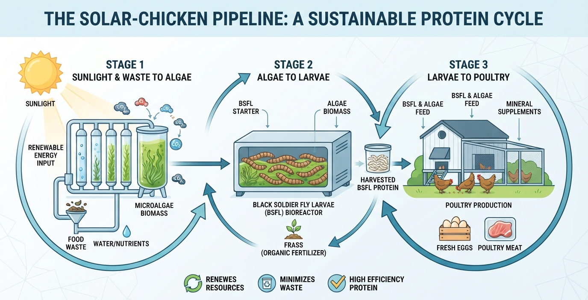

## From sunlight to eggs

1. **Grow algae in sunlit bioreactors.** Light powers growth. The culture also needs water and nutrients, including nitrogen, phosphorus, and trace minerals suited to the algae being grown.
2. **Raise black soldier fly larvae.** The pilot would test harvested algae as [one ingredient in a larval diet](https://www.sciencedirect.com/science/article/pii/S0961953426009402), blended with suitable feed-grade by-products to meet the larvae’s nutritional needs.
3. **Feed the hens.** The larvae would supply part of the protein and fat in a [complete ration formulated for laying hens](https://extension.umn.edu/agriculture/animals-and-livestock/poultry/raising-chickens-for-eggs), alongside the energy, amino acids, calcium, and other minerals and vitamins the flock needs.

## Where SalvageCorps comes in

The Faunamancers will develop the pilot and tend the flock. SalvageCorps will identify farms, produce suppliers, and breweries that can set aside consistent by-products before they get mixed with trash. Clean vegetable trimmings and [spent brewery grains](https://extension.entm.purdue.edu/publications/E-276/E-276.html) are examples to evaluate for the larvae. Suitable produce can also go directly to hens in amounts consistent with a balanced ration. Feed inputs need a known source and [safe handling](https://www.fda.gov/media/97470/download), and must meet applicable animal-feed requirements. Materials with spoilage, chemical contamination, or an unknown handling history stay out of the feed stream.
